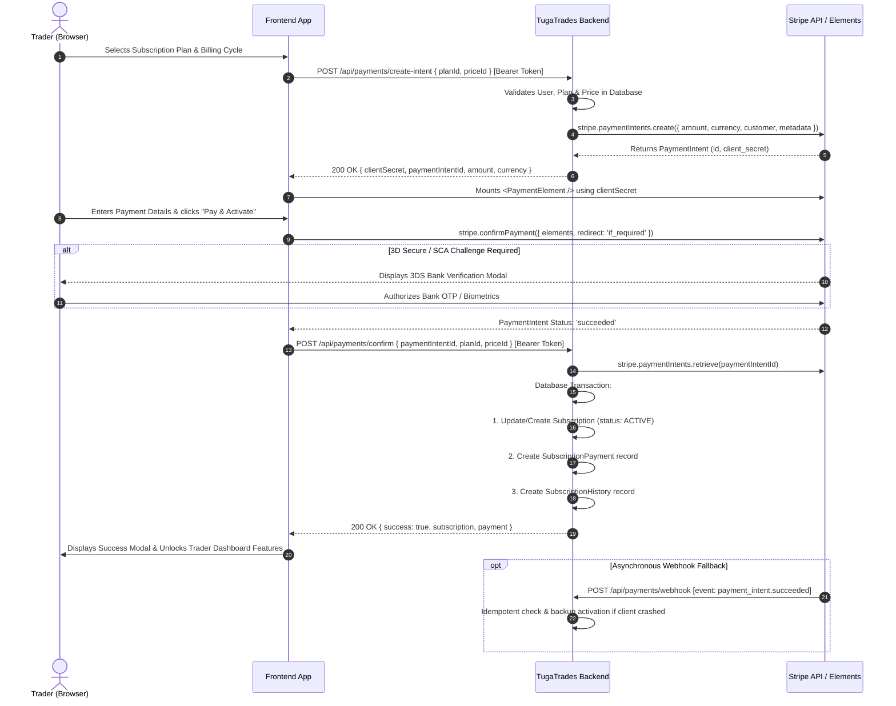

# TugaTrades - Stripe Frontend Integration Guide

> **Target Audience:** Frontend Engineers (React / Next.js / Vue / Mobile)  
> **Backend Version:** NestJS + Prisma ORM + Stripe SDK  
> **API Base URL:** `http://localhost:3000/api` (Local) | `https://tugatraders.server24.in/api` (Production)  
> **Authentication:** Bearer JWT Token (`Authorization: Bearer <token>`)

---

## Table of Contents
1. [Architecture & Payment Flow Overview](#1-architecture--payment-flow-overview)
2. [Backend API Reference](#2-backend-api-reference)
   - [Config Endpoint (`GET /api/payments/config`)](#endpoint-1-get-apipaymentsconfig)
   - [Plans & Prices (`GET /api/admin-plan`)](#endpoint-2-get-apiadmin-plan)
   - [Create PaymentIntent (`POST /api/payments/create-intent`)](#endpoint-3-post-apipaymentscreate-intent)
   - [Confirm Payment & Activate (`POST /api/payments/confirm`)](#endpoint-4-post-apipaymentsconfirm)
   - [Payment History (`GET /api/payments/history`)](#endpoint-5-get-apipaymentshistory)
   - [Subscription Status (`GET /api/subscriptions/my-subscription`)](#endpoint-6-get-apisubscriptionsmy-subscription)
3. [Frontend Implementation (React / Next.js + TypeScript)](#3-frontend-implementation-react--nextjs--typescript)
   - [Step 1: Install Dependencies](#step-1-install-dependencies)
   - [Step 2: Environment Variables](#step-2-environment-variables)
   - [Step 3: API Service Layer (`paymentApi.ts`)](#step-3-api-service-layer-paymentapits)
   - [Step 4: Stripe Client Initializer (`stripe.ts`)](#step-4-stripe-client-initializer-stripets)
   - [Step 5: Stripe Payment Form Component (`CheckoutForm.tsx`)](#step-5-stripe-payment-form-component-checkoutformtsx)
   - [Step 6: Checkout Wrapper & Modal (`SubscriptionCheckout.tsx`)](#step-6-checkout-wrapper--modal-subscriptioncheckouttsx)
   - [Step 7: Plan Selection Page (`PricingPage.tsx`)](#step-7-plan-selection-page-pricingpagetsx)
   - [Step 8: Payment History Component (`PaymentHistory.tsx`)](#step-8-payment-history-component-paymenthistorytsx)
4. [3D Secure (SCA), Edge Cases & Webhook Reconciliation](#4-3d-secure-sca-edge-cases--webhook-reconciliation)
5. [Testing & Stripe Test Cards](#5-testing--stripe-test-cards)
6. [Troubleshooting Checklist](#6-troubleshooting-checklist)

---

## 1. Architecture & Payment Flow Overview

TugaTrades implements Stripe's modern **PaymentIntents API with Stripe Elements**. This design guarantees:
- **Zero PCI Compliance Burden**: Card numbers and CVVs never touch the TugaTrades frontend or backend.
- **Server-Side Price Validation**: The frontend passes `planId` and `priceId`; the backend queries the database directly to prevent price tampering.
- **Strong Customer Authentication (SCA / 3DS)**: Handled seamlessly via Stripe Elements modals.
- **Dual Confirmation & Idempotency**: The client confirms immediately upon payment success, while a backend Stripe Webhook (`payment_intent.succeeded`) acts as a resilient fallback if the client loses network connectivity.

### Sequence Diagram



---

## 2. Backend API Reference

### Global Base Configuration
- **Global API Prefix:** `/api`
- **Authentication Header:** `Authorization: Bearer <user_jwt_token>`

---

### Endpoint 1: `GET /api/payments/config`
Retrieves the Stripe publishable key configured on the server.
- **Auth Required:** No (Public)
- **Response `200 OK`:**
```json
{
  "publishableKey": "pk_test_51...your_publishable_key..."
}
```

---

### Endpoint 2: `GET /api/admin-plan`
Retrieves available subscription tiers (Bronze, Silver, Gold, etc.) with their associated prices.
- **Auth Required:** Yes (`Bearer <token>`)
- **Response `200 OK`:**
```json
[
  {
    "id": "c3e1b7f0-8c29-4d6e-9271-9f93c0d45291",
    "name": "SILVER",
    "description": "Standard trader package with 50 quotes per day",
    "maxQuotesPerDay": 50,
    "maxTrades": 3,
    "trialEnabled": true,
    "trialDays": 14,
    "prices": [
      {
        "id": "a18c3b24-1144-48e0-a924-f7c8d929b3a1",
        "billingCycle": "MONTHLY",
        "amount": 29.99,
        "currency": "EUR",
        "isActive": true
      },
      {
        "id": "b29d4c35-2255-49f1-b035-e8d9e030c4b2",
        "billingCycle": "YEARLY",
        "amount": 299.99,
        "currency": "EUR",
        "isActive": true
      }
    ]
  }
]
```

---

### Endpoint 3: `POST /api/payments/create-intent`
Initializes a Stripe PaymentIntent for the authenticated trader.
- **Auth Required:** Yes (`Bearer <token>`)
- **Headers:** `Content-Type: application/json`
- **Request Body (`CreatePaymentIntentDto`):**
```json
{
  "planId": "c3e1b7f0-8c29-4d6e-9271-9f93c0d45291",
  "priceId": "a18c3b24-1144-48e0-a924-f7c8d929b3a1",
  "currency": "EUR"
}
```
> *Note: If `planId` and `priceId` are passed, backend fetches the exact registered price from the database. Alternatively, an arbitrary `amount` can be supplied for custom one-off payments.*

- **Response `201 Created`:**
```json
{
  "clientSecret": "pi_3MtwBwLkdIwHu7ix28a3tqPa_secret_Yr938bYnU782...",
  "paymentIntentId": "pi_3MtwBwLkdIwHu7ix28a3tqPa",
  "amount": 29.99,
  "currency": "EUR",
  "publishableKey": "pk_test_51..."
}
```

---

### Endpoint 4: `POST /api/payments/confirm`
Notifies the backend that client payment has succeeded. The backend verifies the PaymentIntent with Stripe and activates the subscription inside an ACID transaction.
- **Auth Required:** Yes (`Bearer <token>`)
- **Headers:** `Content-Type: application/json`
- **Request Body (`ConfirmPaymentDto`):**
```json
{
  "paymentIntentId": "pi_3MtwBwLkdIwHu7ix28a3tqPa",
  "planId": "c3e1b7f0-8c29-4d6e-9271-9f93c0d45291",
  "priceId": "a18c3b24-1144-48e0-a924-f7c8d929b3a1"
}
```
- **Response `201 Created`:**
```json
{
  "success": true,
  "message": "Payment confirmed successfully",
  "payment": {
    "id": "e5c1a720-377a-4ec0-9512-1402372b68ab",
    "subscriptionId": "8f3e2b10-2b11-479c-9ab4-1a82b9821ef9",
    "amount": "29.99",
    "currency": "EUR",
    "status": "SUCCESS",
    "paymentProvider": "STRIPE",
    "transactionId": "pi_3MtwBwLkdIwHu7ix28a3tqPa",
    "paidAt": "2026-10-12T16:45:00.000Z",
    "createdAt": "2026-10-12T16:45:00.000Z"
  },
  "subscription": {
    "id": "8f3e2b10-2b11-479c-9ab4-1a82b9821ef9",
    "traderProfileId": "771e82ab-0012-4211-89ab-91023847291a",
    "planId": "c3e1b7f0-8c29-4d6e-9271-9f93c0d45291",
    "currentPlanId": "c3e1b7f0-8c29-4d6e-9271-9f93c0d45291",
    "priceId": "a18c3b24-1144-48e0-a924-f7c8d929b3a1",
    "status": "ACTIVE",
    "isTrial": false,
    "lastChargedAmount": "29.99",
    "nextBillingAmount": "29.99",
    "nextBillingDate": "2026-11-12T16:45:00.000Z",
    "failedPaymentCount": 0,
    "stripeCustomerId": "cus_N7W8x9...",
    "updatedAt": "2026-10-12T16:45:00.000Z"
  }
}
```

---

### Endpoint 5: `GET /api/payments/history`
Retrieves past subscription transactions for the authenticated trader.
- **Auth Required:** Yes (`Bearer <token>`)
- **Response `200 OK`:**
```json
[
  {
    "id": "e5c1a720-377a-4ec0-9512-1402372b68ab",
    "subscriptionId": "8f3e2b10-2b11-479c-9ab4-1a82b9821ef9",
    "amount": "29.99",
    "currency": "EUR",
    "status": "SUCCESS",
    "paymentProvider": "STRIPE",
    "transactionId": "pi_3MtwBwLkdIwHu7ix28a3tqPa",
    "paidAt": "2026-10-12T16:45:00.000Z",
    "failureReason": null,
    "createdAt": "2026-10-12T16:45:00.000Z"
  }
]
```

---

### Endpoint 6: `GET /api/subscriptions/my-subscription`
Retrieves the logged-in trader's current active subscription, limits, and expiration status.
- **Auth Required:** Yes (`Bearer <token>`)
- **Response `200 OK`:**
```json
{
  "success": true,
  "message": "Subscription retrieved successfully",
  "data": {
    "currentPlan": {
      "id": "c3e1b7f0-8c29-4d6e-9271-9f93c0d45291",
      "name": "SILVER",
      "maxQuotesPerDay": 50,
      "maxTrades": 3
    },
    "pendingPlan": null,
    "trial": false,
    "trialEndsAt": null,
    "currentPeriodStart": "2026-10-12T16:45:00.000Z",
    "currentPeriodEnd": "2026-11-12T16:45:00.000Z",
    "billingCycle": "MONTHLY",
    "status": "ACTIVE",
    "lastChargedAmount": "29.99",
    "nextBillingAmount": "29.99"
  }
}
```

---

## 3. Frontend Implementation (React / Next.js + TypeScript)

### Step 1: Install Dependencies
In your frontend project directory:
```bash
npm install @stripe/stripe-js @stripe/react-stripe-js axios
# or
yarn add @stripe/stripe-js @stripe/react-stripe-js axios
# or
pnpm add @stripe/stripe-js @stripe/react-stripe-js axios
```

---

### Step 2: Environment Variables
Create or update `.env.local` (Next.js) or `.env` (Vite/CRA):
```env
# Backend API Base URL
NEXT_PUBLIC_API_URL=http://localhost:3000/api

# Stripe Publishable Key (fallback if not fetched dynamically via /payments/config)
NEXT_PUBLIC_STRIPE_PUBLISHABLE_KEY=pk_test_51...your_stripe_publishable_key...
```

---

### Step 3: API Service Layer (`paymentApi.ts`)
Create `src/services/paymentApi.ts`:

```typescript
// src/services/paymentApi.ts
import axios from 'axios';

const API_BASE_URL = process.env.NEXT_PUBLIC_API_URL || 'http://localhost:3000/api';

const apiClient = axios.create({
  baseURL: API_BASE_URL,
  headers: {
    'Content-Type': 'application/json',
  },
});

// Attach JWT token from localStorage/state automatically
apiClient.interceptors.request.use((config) => {
  const token = typeof window !== 'undefined' ? localStorage.getItem('token') : null;
  if (token && config.headers) {
    config.headers.Authorization = `Bearer ${token}`;
  }
  return config;
});

export interface StripeConfigResponse {
  publishableKey: string;
}

export interface SubscriptionPrice {
  id: string;
  planId: string;
  billingCycle: 'MONTHLY' | 'YEARLY';
  amount: number | string;
  currency: string;
  isActive: boolean;
}

export interface SubscriptionPlan {
  id: string;
  name: string;
  description?: string;
  maxTrades: number;
  unlimitedTrades: boolean;
  maxQuotesPerDay: number;
  trialEnabled: boolean;
  trialDays: number;
  prices: SubscriptionPrice[];
}

export interface CreatePaymentIntentResponse {
  clientSecret: string;
  paymentIntentId: string;
  amount: number;
  currency: string;
  publishableKey: string;
}

export interface ConfirmPaymentResponse {
  success: boolean;
  message: string;
  payment: {
    id: string;
    amount: string;
    currency: string;
    status: string;
    transactionId: string;
    paidAt: string;
  };
  subscription: {
    id: string;
    planId: string;
    status: string;
    nextBillingDate: string;
    billingCycle: string;
  };
}

export const paymentApi = {
  // 1. Get Stripe Publishable Key
  getStripeConfig: async (): Promise<StripeConfigResponse> => {
    const res = await apiClient.get<StripeConfigResponse>('/payments/config');
    return res.data;
  },

  // 2. Fetch Subscription Plans
  getPlans: async (): Promise<SubscriptionPlan[]> => {
    const res = await apiClient.get<SubscriptionPlan[]>('/admin-plan');
    return res.data;
  },

  // 3. Create Stripe PaymentIntent
  createPaymentIntent: async (params: {
    planId: string;
    priceId: string;
    currency?: string;
  }): Promise<CreatePaymentIntentResponse> => {
    const res = await apiClient.post<CreatePaymentIntentResponse>(
      '/payments/create-intent',
      params
    );
    return res.data;
  },

  // 4. Confirm Payment with Backend
  confirmPayment: async (params: {
    paymentIntentId: string;
    planId?: string;
    priceId?: string;
  }): Promise<ConfirmPaymentResponse> => {
    const res = await apiClient.post<ConfirmPaymentResponse>(
      '/payments/confirm',
      params
    );
    return res.data;
  },

  // 5. Payment Transaction History
  getPaymentHistory: async () => {
    const res = await apiClient.get('/payments/history');
    return res.data;
  },

  // 6. Current Subscription Details
  getMySubscription: async () => {
    const res = await apiClient.get('/subscriptions/my-subscription');
    return res.data;
  },
};
```

---

### Step 4: Stripe Client Initializer (`stripe.ts`)
Create `src/lib/stripe.ts` using Stripe's singleton pattern:

```typescript
// src/lib/stripe.ts
import { loadStripe, Stripe } from '@stripe/stripe-js';
import { paymentApi } from '../services/paymentApi';

let stripePromise: Promise<Stripe | null> | null = null;

export const getStripe = async (): Promise<Stripe | null> => {
  if (!stripePromise) {
    stripePromise = (async () => {
      try {
        // Option A: Fetch publishable key from backend endpoint
        const config = await paymentApi.getStripeConfig();
        const key = config.publishableKey || process.env.NEXT_PUBLIC_STRIPE_PUBLISHABLE_KEY;
        if (!key) {
          throw new Error('Stripe Publishable Key not available');
        }
        return await loadStripe(key);
      } catch (err) {
        // Fallback to environment variable
        const fallbackKey = process.env.NEXT_PUBLIC_STRIPE_PUBLISHABLE_KEY || '';
        return fallbackKey ? await loadStripe(fallbackKey) : null;
      }
    })();
  }
  return stripePromise;
};
```

---

### Step 5: Stripe Payment Form Component (`CheckoutForm.tsx`)
Create `src/components/payment/CheckoutForm.tsx`:

```tsx
// src/components/payment/CheckoutForm.tsx
import React, { useState } from 'react';
import {
  useStripe,
  useElements,
  PaymentElement,
} from '@stripe/react-stripe-js';
import { paymentApi } from '../../services/paymentApi';

interface CheckoutFormProps {
  paymentIntentId: string;
  planId: string;
  priceId: string;
  amount: number;
  currency: string;
  onSuccess: (data: any) => void;
  onError: (errorMessage: string) => void;
  onCancel: () => void;
}

export const CheckoutForm: React.FC<CheckoutFormProps> = ({
  paymentIntentId,
  planId,
  priceId,
  amount,
  currency,
  onSuccess,
  onError,
  onCancel,
}) => {
  const stripe = useStripe();
  const elements = useElements();

  const [isProcessing, setIsProcessing] = useState(false);
  const [errorMessage, setErrorMessage] = useState<string | null>(null);

  const handleSubmit = async (e: React.FormEvent) => {
    e.preventDefault();

    if (!stripe || !elements) {
      return; // Stripe has not loaded yet
    }

    setIsProcessing(true);
    setErrorMessage(null);

    try {
      // 1. Confirm payment with Stripe Elements
      // Note: redirect: 'if_required' prevents an unwanted page reload if 3DS is not needed
      const result = await stripe.confirmPayment({
        elements,
        confirmParams: {
          return_url: `${window.location.origin}/subscription/success`,
        },
        redirect: 'if_required',
      });

      if (result.error) {
        const msg = result.error.message || 'Payment processing failed';
        setErrorMessage(msg);
        onError(msg);
        setIsProcessing(false);
        return;
      }

      // 2. Check if PaymentIntent status is succeeded
      if (result.paymentIntent && result.paymentIntent.status === 'succeeded') {
        // 3. Notify backend to activate / upgrade subscription
        const confirmRes = await paymentApi.confirmPayment({
          paymentIntentId: result.paymentIntent.id,
          planId,
          priceId,
        });

        setIsProcessing(false);
        onSuccess(confirmRes);
      } else {
        // E.g., requires_action handled by Stripe modal or processing
        setErrorMessage('Payment is still processing or requires additional verification.');
        setIsProcessing(false);
      }
    } catch (err: any) {
      const msg = err.response?.data?.message || err.message || 'An unexpected error occurred';
      setErrorMessage(msg);
      onError(msg);
      setIsProcessing(false);
    }
  };

  return (
    <form onSubmit={handleSubmit} className="stripe-checkout-form">
      <div className="payment-summary mb-4 p-3 bg-gray-50 rounded">
        <p className="text-sm text-gray-600">Total Due Today:</p>
        <p className="text-2xl font-bold text-gray-900">
          €{amount.toFixed(2)} {currency.toUpperCase()}
        </p>
      </div>

      {/* Stripe PaymentElement dynamically displays Credit Card, Apple Pay, Google Pay, etc. */}
      <div className="mb-4">
        <PaymentElement
          options={{
            layout: 'tabs',
          }}
        />
      </div>

      {errorMessage && (
        <div className="p-3 mb-4 text-sm text-red-700 bg-red-100 rounded border border-red-300">
          {errorMessage}
        </div>
      )}

      <div className="flex gap-3 justify-end mt-6">
        <button
          type="button"
          onClick={onCancel}
          disabled={isProcessing}
          className="px-4 py-2 text-sm font-medium text-gray-700 bg-white border border-gray-300 rounded hover:bg-gray-50 disabled:opacity-50"
        >
          Cancel
        </button>
        <button
          type="submit"
          disabled={!stripe || isProcessing}
          className="px-6 py-2 text-sm font-medium text-white bg-blue-600 rounded hover:bg-blue-700 disabled:opacity-50 flex items-center justify-center min-w-[140px]"
        >
          {isProcessing ? (
            <span className="flex items-center gap-2">
              <svg className="animate-spin h-4 w-4 text-white" viewBox="0 0 24 24">
                <circle className="opacity-25" cx="12" cy="12" r="10" stroke="currentColor" strokeWidth="4" fill="none" />
                <path className="opacity-75" fill="currentColor" d="M4 12a8 8 0 018-8v8H4z" />
              </svg>
              Processing...
            </span>
          ) : (
            `Pay & Activate (€${amount.toFixed(2)})`
          )}
        </button>
      </div>
    </form>
  );
};
```

---

### Step 6: Checkout Wrapper & Modal (`SubscriptionCheckout.tsx`)
Create `src/components/payment/SubscriptionCheckout.tsx`:

```tsx
// src/components/payment/SubscriptionCheckout.tsx
import React, { useEffect, useState } from 'react';
import { Elements } from '@stripe/react-stripe-js';
import { Stripe } from '@stripe/stripe-js';
import { getStripe } from '../../lib/stripe';
import { paymentApi } from '../../services/paymentApi';
import { CheckoutForm } from './CheckoutForm';

interface SubscriptionCheckoutProps {
  planId: string;
  priceId: string;
  isOpen: boolean;
  onClose: () => void;
  onPaymentSuccess: (res: any) => void;
}

export const SubscriptionCheckout: React.FC<SubscriptionCheckoutProps> = ({
  planId,
  priceId,
  isOpen,
  onClose,
  onPaymentSuccess,
}) => {
  const [stripeInstance, setStripeInstance] = useState<Stripe | null>(null);
  const [clientSecret, setClientSecret] = useState<string>('');
  const [paymentIntentId, setPaymentIntentId] = useState<string>('');
  const [amount, setAmount] = useState<number>(0);
  const [currency, setCurrency] = useState<string>('EUR');
  const [loading, setLoading] = useState<boolean>(true);
  const [initError, setInitError] = useState<string | null>(null);

  useEffect(() => {
    if (!isOpen) return;

    let isMounted = true;

    async function initCheckout() {
      setLoading(true);
      setInitError(null);

      try {
        // 1. Initialize Stripe JS SDK instance
        const stripe = await getStripe();
        if (isMounted) setStripeInstance(stripe);

        // 2. Request PaymentIntent from backend
        const intentData = await paymentApi.createPaymentIntent({
          planId,
          priceId,
        });

        if (isMounted) {
          setClientSecret(intentData.clientSecret);
          setPaymentIntentId(intentData.paymentIntentId);
          setAmount(intentData.amount);
          setCurrency(intentData.currency);
          setLoading(false);
        }
      } catch (err: any) {
        if (isMounted) {
          const msg =
            err.response?.data?.message || err.message || 'Failed to initialize payment session';
          setInitError(msg);
          setLoading(false);
        }
      }
    }

    initCheckout();

    return () => {
      isMounted = false;
    };
  }, [isOpen, planId, priceId]);

  if (!isOpen) return null;

  return (
    <div className="fixed inset-0 z-50 flex items-center justify-center bg-black bg-opacity-50 p-4">
      <div className="bg-white rounded-xl shadow-2xl max-w-lg w-full p-6 relative">
        <button
          onClick={onClose}
          className="absolute top-4 right-4 text-gray-400 hover:text-gray-600 text-xl font-bold"
        >
          ✕
        </button>

        <h2 className="text-xl font-bold text-gray-900 mb-2">Subscribe to Plan</h2>
        <p className="text-sm text-gray-500 mb-6">
          Enter your payment details below to activate your subscription.
        </p>

        {loading && (
          <div className="flex flex-col items-center justify-center py-12">
            <div className="animate-spin rounded-full h-10 w-10 border-b-2 border-blue-600 mb-4"></div>
            <p className="text-sm text-gray-500">Preparing secure checkout session...</p>
          </div>
        )}

        {initError && (
          <div className="p-4 bg-red-50 text-red-700 rounded-lg border border-red-200">
            <p className="font-semibold mb-1">Initialization Error</p>
            <p className="text-sm">{initError}</p>
            <button
              onClick={onClose}
              className="mt-4 px-4 py-2 text-sm bg-red-600 text-white rounded hover:bg-red-700"
            >
              Close
            </button>
          </div>
        )}

        {!loading && !initError && clientSecret && stripeInstance && (
          <Elements
            stripe={stripeInstance}
            options={{
              clientSecret,
              appearance: {
                theme: 'stripe',
                variables: {
                  colorPrimary: '#2563eb', // Indigo / Blue primary
                  colorBackground: '#ffffff',
                  colorText: '#1f2937',
                  borderRadius: '8px',
                },
              },
            }}
          >
            <CheckoutForm
              paymentIntentId={paymentIntentId}
              planId={planId}
              priceId={priceId}
              amount={amount}
              currency={currency}
              onSuccess={(res) => {
                onPaymentSuccess(res);
                onClose();
              }}
              onError={(err) => console.error('Payment Error:', err)}
              onCancel={onClose}
            />
          </Elements>
        )}
      </div>
    </div>
  );
};
```

---

### Step 7: Plan Selection Page (`PricingPage.tsx`)
Create `src/pages/PricingPage.tsx` or `src/app/pricing/page.tsx`:

```tsx
// src/pages/PricingPage.tsx
import React, { useEffect, useState } from 'react';
import { paymentApi, SubscriptionPlan } from '../services/paymentApi';
import { SubscriptionCheckout } from '../components/payment/SubscriptionCheckout';

export const PricingPage: React.FC = () => {
  const [plans, setPlans] = useState<SubscriptionPlan[]>([]);
  const [billingCycle, setBillingCycle] = useState<'MONTHLY' | 'YEARLY'>('MONTHLY');
  const [selectedPlanId, setSelectedPlanId] = useState<string | null>(null);
  const [selectedPriceId, setSelectedPriceId] = useState<string | null>(null);
  const [isModalOpen, setIsModalOpen] = useState(false);
  const [successBanner, setSuccessBanner] = useState<string | null>(null);

  useEffect(() => {
    paymentApi
      .getPlans()
      .then((data) => setPlans(data))
      .catch((err) => console.error('Failed to load plans:', err));
  }, []);

  const handleSelectPlan = (plan: SubscriptionPlan) => {
    const priceObj = plan.prices.find((p) => p.billingCycle === billingCycle);
    if (!priceObj) {
      alert(`No ${billingCycle.toLowerCase()} price available for this plan.`);
      return;
    }
    setSelectedPlanId(plan.id);
    setSelectedPriceId(priceObj.id);
    setIsModalOpen(true);
  };

  return (
    <div className="max-w-7xl mx-auto px-4 py-12">
      <div className="text-center mb-10">
        <h1 className="text-3xl font-extrabold text-gray-900 sm:text-4xl">
          Upgrade Your TugaTrades Subscription
        </h1>
        <p className="mt-3 text-lg text-gray-500">
          Unlock higher quote quotas, portfolio visibility, and priority support.
        </p>

        {/* Billing Cycle Switcher */}
        <div className="mt-6 flex justify-center">
          <div className="bg-gray-100 p-1 rounded-lg flex space-x-1">
            <button
              onClick={() => setBillingCycle('MONTHLY')}
              className={`px-4 py-2 rounded-md text-sm font-semibold transition ${
                billingCycle === 'MONTHLY'
                  ? 'bg-white text-gray-900 shadow'
                  : 'text-gray-600 hover:text-gray-900'
              }`}
            >
              Monthly Billing
            </button>
            <button
              onClick={() => setBillingCycle('YEARLY')}
              className={`px-4 py-2 rounded-md text-sm font-semibold transition ${
                billingCycle === 'YEARLY'
                  ? 'bg-white text-gray-900 shadow'
                  : 'text-gray-600 hover:text-gray-900'
              }`}
            >
              Yearly Billing (Save up to 20%)
            </button>
          </div>
        </div>
      </div>

      {successBanner && (
        <div className="mb-8 p-4 bg-green-50 border border-green-200 text-green-800 rounded-lg text-center font-medium">
          🎉 {successBanner}
        </div>
      )}

      {/* Pricing Cards Grid */}
      <div className="grid grid-cols-1 md:grid-cols-3 gap-8">
        {plans.map((plan) => {
          const priceObj = plan.prices.find((p) => p.billingCycle === billingCycle);
          const price = priceObj ? Number(priceObj.amount) : 0;

          return (
            <div
              key={plan.id}
              className="bg-white border rounded-2xl p-6 shadow-sm hover:shadow-md flex flex-col justify-between"
            >
              <div>
                <h3 className="text-xl font-bold text-gray-900">{plan.name}</h3>
                <p className="text-sm text-gray-500 mt-2 min-h-[40px]">{plan.description}</p>
                <div className="mt-4 mb-6">
                  <span className="text-4xl font-extrabold text-gray-900">€{price.toFixed(2)}</span>
                  <span className="text-gray-500 text-sm"> / {billingCycle.toLowerCase().slice(0, 2)}</span>
                </div>

                <ul className="space-y-3 text-sm text-gray-600 border-t pt-4">
                  <li>✓ Up to {plan.maxQuotesPerDay} quotes per day</li>
                  <li>✓ {plan.unlimitedTrades ? 'Unlimited' : plan.maxTrades} trade categories</li>
                  {plan.trialEnabled && (
                    <li className="text-blue-600 font-medium">
                      ★ Includes {plan.trialDays}-day free trial
                    </li>
                  )}
                </ul>
              </div>

              <button
                onClick={() => handleSelectPlan(plan)}
                className="mt-8 w-full bg-blue-600 text-white font-medium py-2.5 rounded-lg hover:bg-blue-700 transition"
              >
                Choose {plan.name}
              </button>
            </div>
          );
        })}
      </div>

      {/* Subscription Checkout Modal */}
      {selectedPlanId && selectedPriceId && (
        <SubscriptionCheckout
          planId={selectedPlanId}
          priceId={selectedPriceId}
          isOpen={isModalOpen}
          onClose={() => setIsModalOpen(false)}
          onPaymentSuccess={(res) => {
            setSuccessBanner(`Your ${res.subscription.status} subscription has been activated!`);
          }}
        />
      )}
    </div>
  );
};
```

---

### Step 8: Payment History Component (`PaymentHistory.tsx`)
Create `src/components/payment/PaymentHistory.tsx`:

```tsx
// src/components/payment/PaymentHistory.tsx
import React, { useEffect, useState } from 'react';
import { paymentApi } from '../../services/paymentApi';

export const PaymentHistory: React.FC = () => {
  const [history, setHistory] = useState<any[]>([]);
  const [loading, setLoading] = useState(true);

  useEffect(() => {
    paymentApi
      .getPaymentHistory()
      .then((data) => setHistory(data))
      .catch((err) => console.error(err))
      .finally(() => setLoading(false));
  }, []);

  if (loading) return <p className="text-gray-500">Loading billing history...</p>;

  return (
    <div className="bg-white rounded-lg shadow overflow-hidden">
      <div className="px-6 py-4 border-b border-gray-200">
        <h3 className="text-lg font-semibold text-gray-800">Billing & Payment History</h3>
      </div>
      <table className="min-w-full divide-y divide-gray-200">
        <thead className="bg-gray-50 text-xs font-semibold text-gray-500 uppercase">
          <tr>
            <th className="px-6 py-3 text-left">Date</th>
            <th className="px-6 py-3 text-left">Amount</th>
            <th className="px-6 py-3 text-left">Provider</th>
            <th className="px-6 py-3 text-left">Status</th>
            <th className="px-6 py-3 text-left">Transaction ID</th>
          </tr>
        </thead>
        <tbody className="divide-y divide-gray-200 text-sm">
          {history.length === 0 ? (
            <tr>
              <td colSpan={5} className="px-6 py-4 text-center text-gray-400">
                No past transactions found.
              </td>
            </tr>
          ) : (
            history.map((tx) => (
              <tr key={tx.id}>
                <td className="px-6 py-4 text-gray-600">
                  {new Date(tx.paidAt || tx.createdAt).toLocaleDateString()}
                </td>
                <td className="px-6 py-4 font-medium text-gray-900">
                  €{Number(tx.amount).toFixed(2)} {tx.currency}
                </td>
                <td className="px-6 py-4 text-gray-600">{tx.paymentProvider}</td>
                <td className="px-6 py-4">
                  <span
                    className={`inline-flex px-2 py-1 text-xs font-semibold rounded-full ${
                      tx.status === 'SUCCESS'
                        ? 'bg-green-100 text-green-800'
                        : 'bg-red-100 text-red-800'
                    }`}
                  >
                    {tx.status}
                  </span>
                </td>
                <td className="px-6 py-4 text-gray-500 font-mono text-xs">{tx.transactionId}</td>
              </tr>
            ))
          )}
        </tbody>
      </table>
    </div>
  );
};
```

---

## 4. 3D Secure (SCA), Edge Cases & Webhook Reconciliation

### 1. Handling 3D Secure Authentication
When European or international cards require Strong Customer Authentication (SCA), calling:
```typescript
const result = await stripe.confirmPayment({
  elements,
  confirmParams: { return_url: window.location.href },
  redirect: 'if_required',
});
```
will automatically open the issuer bank's 3DS challenge in an inline iframe or popup modal. The user completes the OTP or biometric authorization, and Stripe resolves the promise without performing a full-page redirect!

### 2. Browser Tab Closure / Network Drop Fallback
If a user completes 3DS verification and closes the browser tab before `POST /api/payments/confirm` executes:
- Stripe's webhook system sends a `payment_intent.succeeded` event directly to our backend at `POST /api/payments/webhook`.
- The backend's `handlePaymentIntentSucceeded` method automatically:
  1. Verifies the event signature (`stripe-signature`).
  2. Runs an idempotency check against `subscriptionPayment.transactionId`.
  3. Activates the subscription and logs the payment in the database.
- When the user logs back in, `GET /api/subscriptions/my-subscription` will already show the updated active subscription.

---

## 5. Testing & Stripe Test Cards

Use Stripe's official test card numbers in test mode (`pk_test_...`):

| Test Scenario | Card Number | MM/YY | CVC | Expected Result |
| :--- | :--- | :---: | :---: | :--- |
| **Successful Payment** | `4242 •••• •••• 4242` | Any future date | Any 3 digits | Instant success, subscription activated |
| **3D Secure (SCA) Challenge** | `4000 0027 6000 3184` | Any future date | Any 3 digits | Opens 3DS modal; click "Complete Authentication" |
| **3DS Authentication Fails** | `4000 0002 0115 3184` | Any future date | Any 3 digits | 3DS challenge fails; error message displayed |
| **Insufficient Funds** | `4000 0000 0000 9995` | Any future date | Any 3 digits | Declined: Insufficient funds |
| **Card Expired** | `4000 0000 0000 0069` | Any future date | Any 3 digits | Declined: Card expired |

---

## 6. Troubleshooting Checklist

| Issue | Root Cause | Solution |
| :--- | :--- | :--- |
| `401 Unauthorized: Token missing or session expired` | Missing or invalid `Authorization` header | Ensure user has logged in and JWT token is prefixed with `Bearer ` in the header. |
| `400 BadRequest: Subscription plan / price not found` | Invalid or mismatched UUIDs in request payload | Verify that `planId` and `priceId` match the IDs returned by `GET /api/admin-plan`. |
| `Stripe Elements: Missing clientSecret` | ClientSecret was empty when `<Elements>` mounted | Only render `<Elements options={{ clientSecret }}>` once `clientSecret` has been fetched from `POST /api/payments/create-intent`. |
| `CORS error in browser console` | Frontend origin is not whitelisted in backend `main.ts` | Verify that the frontend origin (`http://localhost:3000`, `http://localhost:3001`, etc.) is in `ALLOWED_ORIGINS` in the backend `.env`. |
| `Webhook 400 signature verification failed` | `rawBody` parser missing or incorrect `STRIPE_WEBHOOK_SECRET` | Backend already sets `NestFactory.create(AppModule, { rawBody: true })`. Ensure `STRIPE_WEBHOOK_SECRET` in `.env` matches the Stripe dashboard webhook signing secret. |
